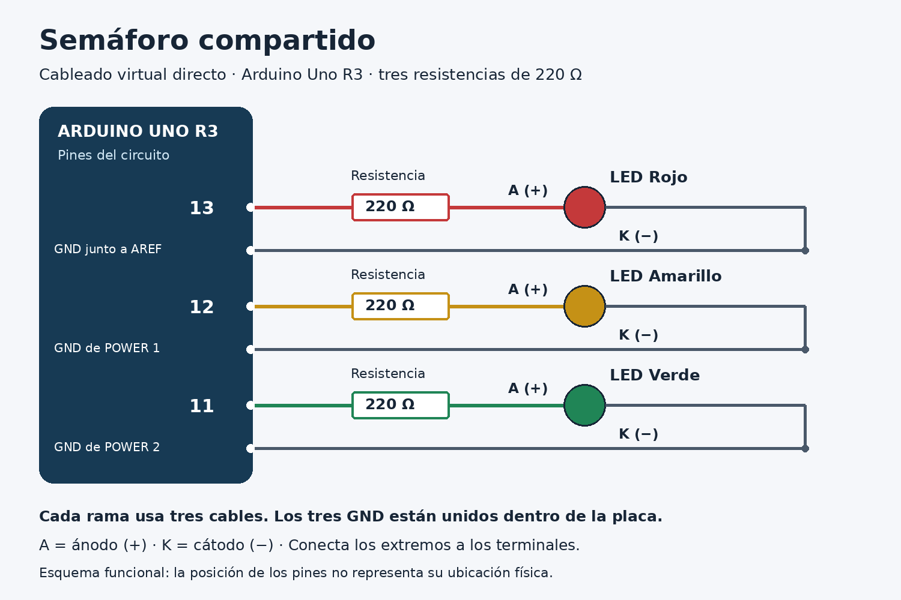

# Semáforo compartido: tu primer circuito con Arduino en Tinkercad

**Curso:** Activadores de Comunidades de Práctica · SENACYT / CENFOTEC.  
**Público:** docentes y estudiantes principiantes de Panamá y Costa Rica.  
**Duración estimada:** 20–30 minutos con la cuenta iniciada; puede tomar más la primera vez.  
**Versión 0.2:** guía revisada y pruebas internas del circuito realizadas en Autodesk Tinkercad. Según el reporte del Grupo 5, los LED rojo, amarillo y verde encendieron correctamente en secuencia. No se aportaron mediciones verificables de las duraciones ni registros de revisión por otro grupo.


**Proyecto en Tinkercad:** [Semáforo Grupo 5](https://www.tinkercad.com/things/159oklSwmbn-semaforo-grupo-5?sharecode=Hu2hL66F69LfDO6nUz_bjbiNr8pTk8fxQz1K8weei0w)

## Para qué sirve

Simularás un semáforo de tres LED —pequeñas luces electrónicas—: **rojo 8 segundos → verde 8 segundos → amarillo 3 segundos**. Podrás relacionar conexiones e instrucciones, modificar un tiempo y dejar una mejora para quien continúe la experiencia.

## Qué necesitás

* Computadora con internet, navegador y acceso a [Tinkercad](https://www.tinkercad.com/). Comprueba tu cuenta o acceso de clase antes de comenzar.
* Saber arrastrar elementos y copiar texto; no necesitas programar todavía.
* **Componentes virtuales:** 1 Arduino Uno R3, 3 LED individuales —rojo, amarillo y verde— y 3 resistencias de **220 Ω**.
* **9 conexiones de cable:** se crean pulsando terminales; no se buscan como componentes.

Trabajarás directamente entre terminales, sin protoboard. El código completo está aquí. GitHub solo requiere cuenta para publicar aportes.

## Cómo hacerlo

### 1\. Crear el espacio de trabajo

Entra en Tinkercad, abre **Circuitos / Circuits** y elige **Crear nuevo circuito / Create new Circuit**. Ponle el nombre `Semáforo compartido`. Los nombres de los botones pueden variar según el idioma.

### 2\. Agregar y preparar los componentes

Arrastra un **Arduino Uno R3**, tres **LED** y tres **Resistencia / Resistor**. Si falta alguno, cambia el filtro a **Todos / All**.

Selecciona cada LED, asigna su color y ordénalos: rojo, amarillo y verde. Selecciona cada resistencia y fija **220 Ω**, no kΩ. La resistencia limita la corriente del LED.

### 3\. Conectar los nueve cables

Con la simulación detenida, pulsa el terminal de origen y luego el de destino para crear cada cable. Acercar componentes o cruzar cables no establece una conexión.

Pasa el puntero por los terminales del LED para identificar **ánodo (A, +)** y **cátodo (K, −)**. En un LED físico corresponden generalmente a la pata larga y corta, respectivamente; en pantalla confirma las etiquetas.

Conecta **tres cables por fila**, siguiendo esta tabla:

|LED|Cable 1|Cable 2|Cable 3|
|-|-|-|-|
|Rojo|Pin **13** → extremo de su resistencia|Otro extremo de esa resistencia → **ánodo** del rojo|**Cátodo** del rojo → **GND junto a AREF y 13**|
|Amarillo|Pin **12** → extremo de su resistencia|Otro extremo de esa resistencia → **ánodo** del amarillo|**Cátodo** del amarillo → uno de los **GND de POWER**|
|Verde|Pin **11** → extremo de su resistencia|Otro extremo de esa resistencia → **ánodo** del verde|**Cátodo** del verde → el otro **GND de POWER**|

Los dos GND de POWER están entre **5V y VIN**. Los tres GND comparten la misma referencia eléctrica. Usa uno distinto por LED. Las resistencias no tienen orientación; **cada LED lleva la suya**.



El esquema es funcional: no reproduce la posición física de los pines. La tabla permite montar sin ver la imagen.

### 4\. Pegar el programa

Abre **Código / Code → Texto / Text**. Acepta el aviso de cambio de editor en este circuito nuevo. Sustituye todo el programa por este código, sin copiar las marcas Markdown de tres acentos graves:

```cpp
// Semaforo compartido: Arduino Uno R3.
// Rojo: 13; amarillo: 12; verde: 11.
// Una resistencia de 220 ohmios en serie con cada LED.
const int rojo = 13;
const int amarillo = 12;
const int verde = 11;

void setup() {
  pinMode(rojo, OUTPUT);
  pinMode(amarillo, OUTPUT);
  pinMode(verde, OUTPUT);
  digitalWrite(rojo, LOW);
  digitalWrite(amarillo, LOW);
  digitalWrite(verde, LOW);
}

void loop() {
  // Fase roja: 8 segundos.
  digitalWrite(verde, LOW);
  digitalWrite(amarillo, LOW);
  digitalWrite(rojo, HIGH);
  delay(8000);

  // Fase verde: 8 segundos.
  digitalWrite(rojo, LOW);
  digitalWrite(amarillo, LOW);
  digitalWrite(verde, HIGH);
  delay(8000);

  // Fase amarilla: 3 segundos.
  digitalWrite(rojo, LOW);
  digitalWrite(verde, LOW);
  digitalWrite(amarillo, HIGH);
  delay(3000);
}
```

`setup()` prepara las salidas una vez. `loop()` repite las fases. En este circuito, `HIGH` enciende un LED y `LOW` lo apaga. `delay(8000)` espera 8000 milisegundos, equivalentes a 8 segundos.

### 5\. Iniciar y observar

Pulsa **Iniciar simulación / Start Simulation** y observa **los tres LED externos** durante dos ciclos. El LED integrado **L** también usa el pin 13 y puede acompañar al rojo; no lo cuentes como parte del semáforo.

## Cómo comprobar que funcionó

Usa el tiempo del simulador; si la computadora está lenta puede diferir del tiempo de tu reloj.

|Tiempo aproximado desde el inicio|LED externo encendido|Los otros dos|
|-|-|-|
|0 a menos de 8 segundos|Rojo|Apagados|
|8 a menos de 16 segundos|Verde|Apagados|
|16 a menos de 19 segundos|Amarillo|Apagados|
|Al llegar a 19 segundos|Vuelve el rojo|Comienza otro ciclo|

La prueba pasa si hay **un solo LED externo encendido por fase**, en el orden indicado, y el ciclo se repite. Dos ciclos duran unos **38 segundos de simulación**. Registra cualquier diferencia.

**Variante opcional:** después de verificar el original, detén la simulación y cambia `delay(3000)` por `delay(5000)`. Al reiniciar, el amarillo debe durar 5 segundos y el ciclo 21. Documenta el cambio.

## Qué aprendimos y qué falta resolver

La práctica relaciona salidas y tiempos. Se contrastó la guía con fuentes oficiales y se comprobó la lógica del código localmente, como se describe en la revisión con IA. Además, el Grupo 5 reportó haber ejecutado el circuito en Tinkercad y observado correctamente la secuencia de los tres LED. No se dispone aquí de mediciones del tiempo de cada fase ni de una evaluación independiente por personas principiantes.

|Si ocurre esto|Revisa esto|
|-|-|
|Un LED no enciende|Ánodo hacia la resistencia, cátodo hacia GND y cables unidos a terminales.|
|Solo parpadea el LED pequeño de la placa|Que esté cargado el programa completo y que los LED externos estén conectados.|
|Se enciende un color distinto|Correspondencia de los pines: 13 rojo, 12 amarillo, 11 verde.|
|Una luz es muy tenue o aparece una advertencia|Valor de cada resistencia: **220 Ω**, y una resistencia por LED.|
|El programa muestra un error|Editor en Texto, bloque completo, llaves y puntos y coma; no copies las marcas Markdown.|

**Pendiente de documentar:** fecha y participantes específicos de las pruebas internas, mediciones de los tiempos si se realizaron, interpretación de otro grupo y duración real del taller con personas principiantes. El montaje físico y la programación por bloques quedan como ampliaciones opcionales. No se presenta como realizada ninguna de esas actividades sin evidencia.

## Cómo podés contribuir

**Ayúdanos a aclarar una instrucción.** Lee o prueba la guía e indica el primer paso que requiere ayuda: número, qué entendiste y cómo lo aclararías. También sirve confirmar que pudiste seguirla.

En este repositorio abre **Issues → New issue**, con el título `Prueba de la guía del semáforo`. Incluye **tipo de revisión** —lectura o simulación—, **paso**, **resultado o duda** y **sugerencia**. Copia cualquier mensaje de error; la captura del circuito es opcional.

Sin GitHub, envía esos datos por el canal del curso. El grupo podrá registrarlos con tu autorización. No hace falta programar para aportar.

## Autoría y fuentes

**Grupo:** Grupo 5 — Activación Comunitaria.  
**Integrantes:** Guillermo Javier González Montenegro; Olmedo Alexander Alonso Madrigales; Laura Victoria Vente Urbano; Roselyn Montenegro Othón; Jeniree Parra Rocco; Fernando Ulises Barría; Leonel Azael Montezuma Bejerano; Vianca Cuevas; Esteban Bejerano.  
**Aportes:** se propuso una distribución de roles en [ENTREGA.md](../ENTREGA.md). Las contribuciones individuales específicas deben validarse con las personas involucradas antes de atribuirlas como hechos.  
**Origen:** adaptación educativa de una práctica introductoria de semáforo con Arduino Uno; las contribuciones y experiencias previas concretas se registrarán cuando sean confirmadas.  
**Apoyo de IA:** revisión de claridad y comprobación local de la lógica; ver [revisión con IA](../revision/revision-ia.md). El grupo reportó pruebas internas en Tinkercad; permanece sin documentarse una revisión externa de la guía.

Fuentes de consulta —enlaces a materiales originales, sin incorporar sus imágenes—:

* [Arduino: Blink](https://docs.arduino.cc/built-in-examples/basics/Blink/) — LED, polaridad y resistencia en serie.
* [Arduino Uno R3: distribución oficial de pines](https://content.arduino.cc/assets/A000066-full-pinout.pdf) — identificación de salidas y GND.
* [Arduino: delay()](https://docs.arduino.cc/language-reference/en/functions/time/delay/) — tiempos en milisegundos.
* [Autodesk: guía oficial de Tinkercad Circuits](https://images.tinkercad.com/jl5ii4oqrdmc/4sMFqe3rDlbUymJt0I4yh/85a4487f7fe274e74c19870ae4679fc1/tinkercad-guides_circuits-Printable.pdf) — uso del editor y simulación.

**Reutilización:** el Grupo 5 confirmó CC BY 4.0 para sus contribuciones originales sobre las que tenga derechos; reconocer autoría, enlazar la licencia e indicar cambios. Los materiales de terceros conservan sus respectivas condiciones. Ver [LICENCIA.md](../LICENCIA.md) para créditos y alcance.

## Revisión durante la clase

**Estado:** no se han aportado respuestas ni datos verificables de una revisión por otro grupo. Este apartado documenta el estado de esa actividad sin atribuir respuestas imaginarias. Las pruebas internas del circuito en Tinkercad fueron reportadas por el Grupo 5 y se consignan por separado.

| Pregunta del reto | Resultado de la revisión externa |
| --- | --- |
| ¿Qué podemos hacer con este recurso? | No hay respuesta registrada de otro grupo. |
| ¿Qué necesitamos para comenzar? | No hay respuesta registrada de otro grupo. |
| ¿Cuál sería el primer paso? | No hay respuesta registrada de otro grupo. |
| ¿Cómo sabríamos que funcionó? | No hay respuesta registrada de otro grupo. |
| ¿Dónde necesitaríamos pedir ayuda? | No hay respuesta registrada de otro grupo. |

- **Fecha y grupo revisor externo:** no confirmados.
- **Modalidad de revisión externa:** no documentada.
- **Explicaciones orales dadas a otro grupo:** no documentadas.
- **Ajustes derivados de comentarios de otro grupo:** no documentados.
- **Prueba interna de funcionamiento:** realizada según el reporte del Grupo 5; los tres LED encendieron secuencialmente. [Circuito en Tinkercad](https://www.tinkercad.com/things/159oklSwmbn-semaforo-grupo-5?sharecode=Hu2hL66F69LfDO6nUz_bjbiNr8pTk8fxQz1K8weei0w).
- **Prueba práctica de otro grupo:** sin evidencia registrada.

El detalle del estado y los futuros aportes se conserva en el [registro de clase](../revision/registro-clase.md). Comprender la guía no equivale a ejecutar el circuito.
